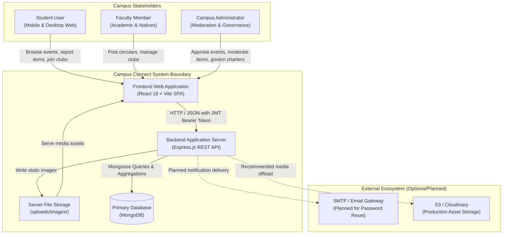
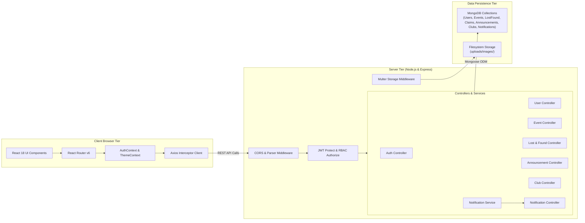
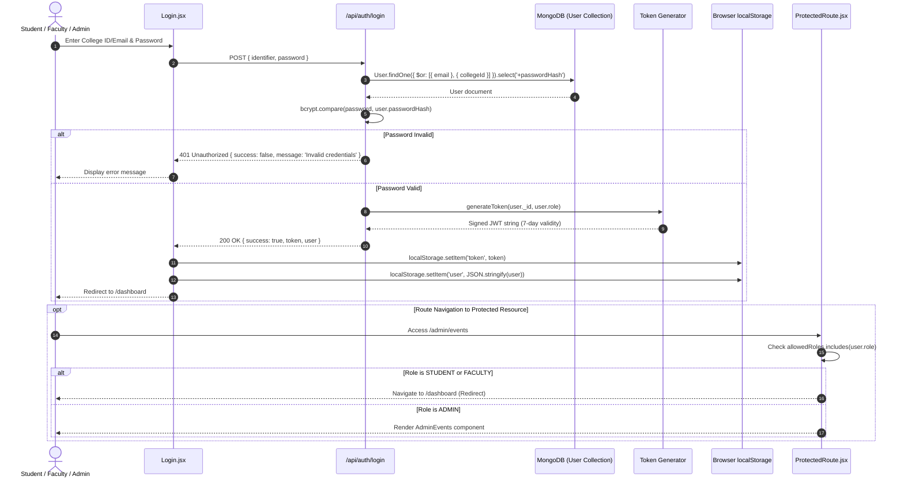
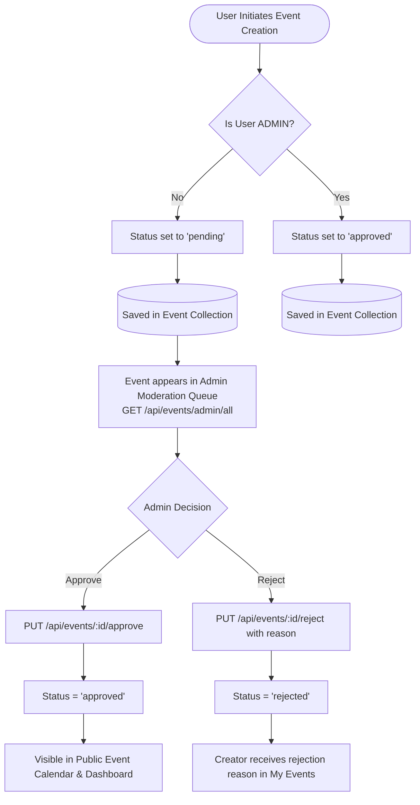
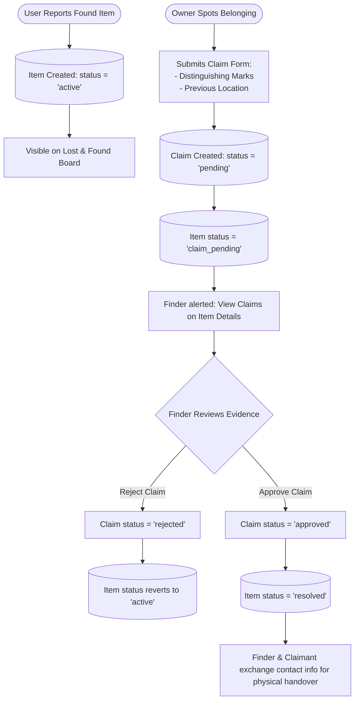
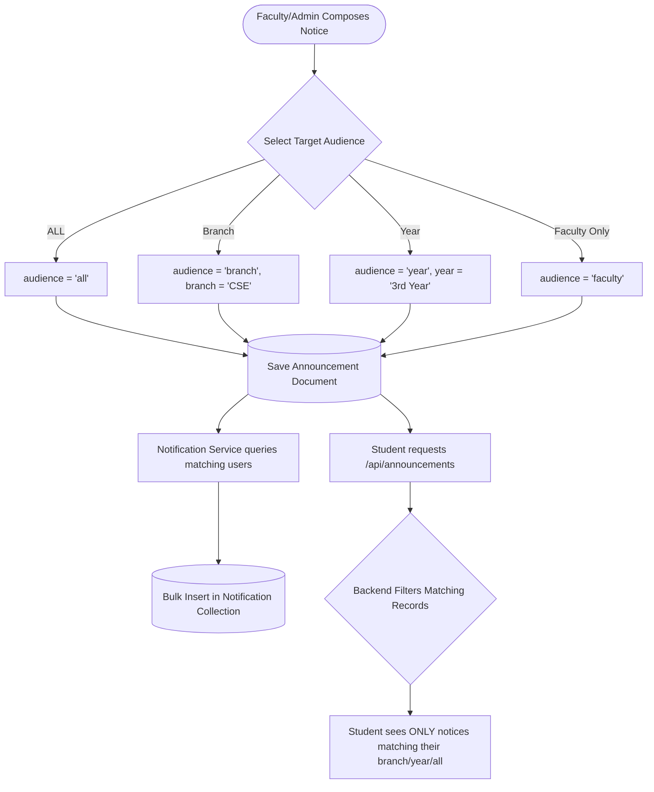
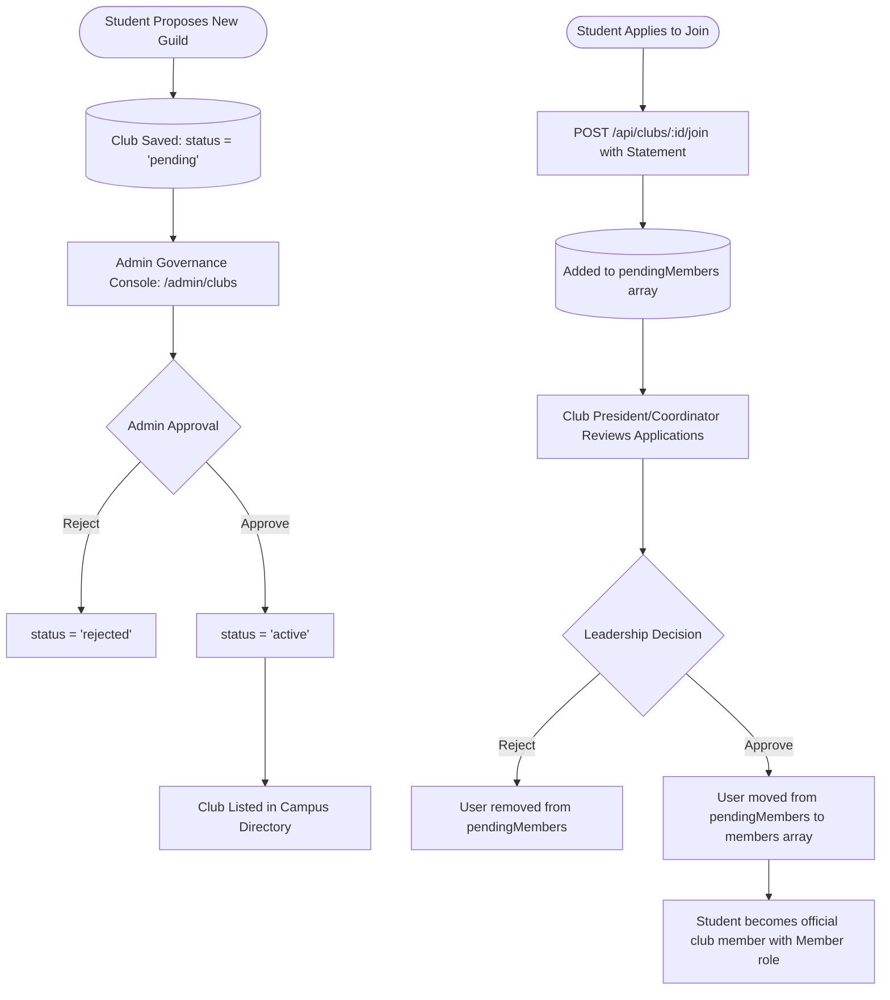
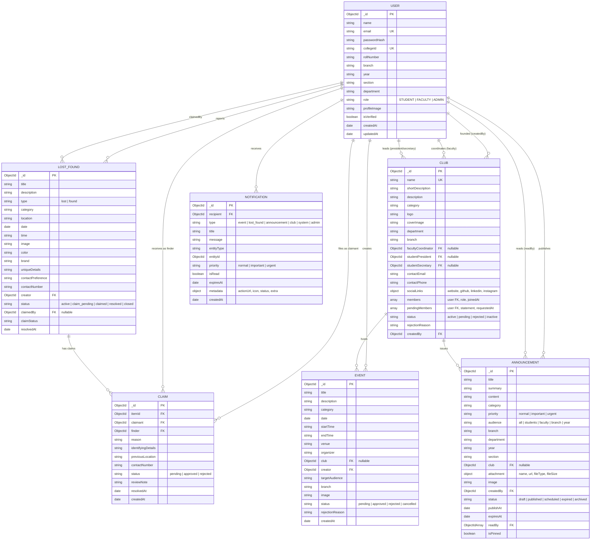
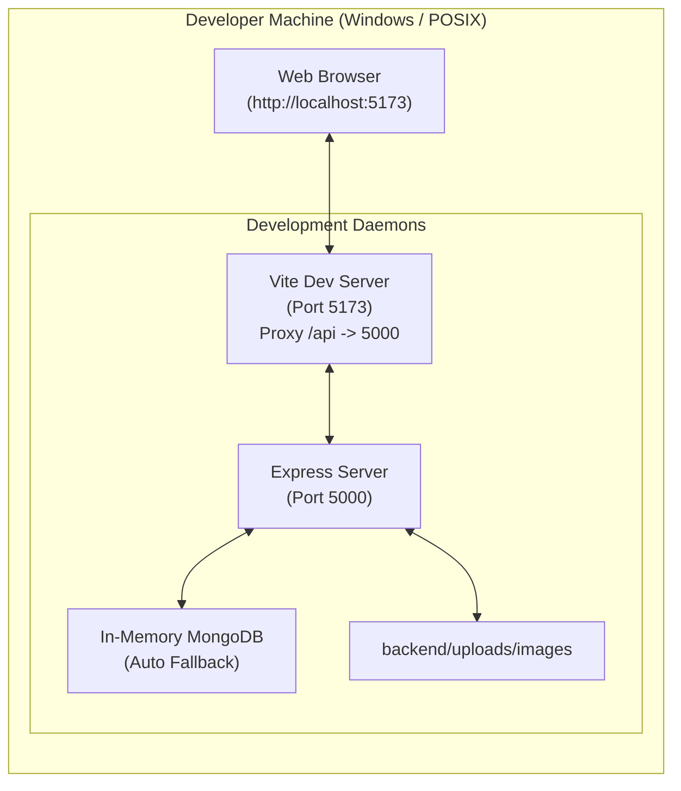
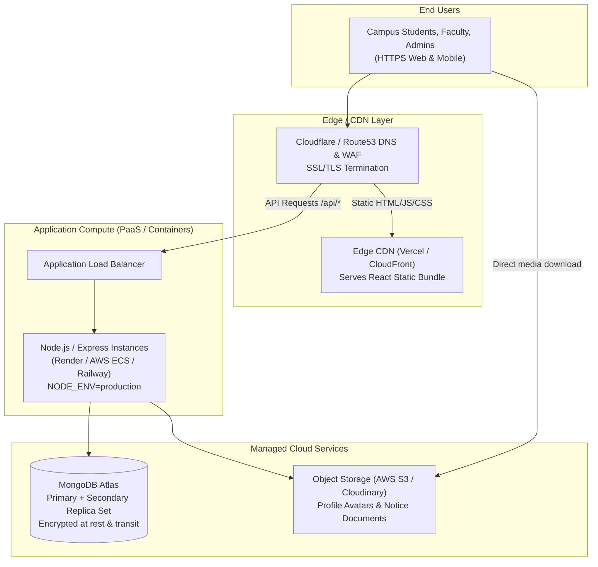

# Campus Connect — System Design & Architecture Specification

## 1. High-Level System Context

Campus Connect is an institutional portal serving three primary user personas: **Students**, **Faculty Members**, and **Central Campus Administrators**. The system operates as a client-server web application communicating via RESTful JSON over HTTP/S.



### Trust Boundaries & Network Segregation
- **Trust Boundary 1 (Public / Client Boundary)**: Between user web browsers and the Express API server. All incoming requests across this boundary are treated as untrusted and must pass through CORS validation, body parsing, and JWT authentication middleware.
- **Trust Boundary 2 (Application / Data Boundary)**: Between Express controllers and MongoDB. Controllers strictly enforce user ownership and role checks before issuing database write/delete queries.
- **Trust Boundary 3 (File Storage Boundary)**: Multipart upload files are validated for size (10 MB maximum) and MIME type (`image/jpeg`, `image/png`, `image/webp`) before writing to the filesystem.

---

## 2. Container & Component Architecture



---

## 3. Frontend-to-Backend Request Flow

Every authenticated request from the client follows a uniform lifecycle:

```mermaid
sequenceDiagram
    autonumber
    actor User as User Browser
    participant React as React UI Page
    participant Axios as Axios API Client
    participant Express as Express Router
    participant AuthMW as Protect Middleware
    participant Controller as Feature Controller
    participant DB as MongoDB Instance

    User->>React: Performs User Action (e.g. Host Event)
    React->>Axios: api.post('/events', payload)
    Axios->>Axios: Interceptor attaches Bearer <token> from localStorage
    Axios->>Express: POST /api/events (HTTP Header: Authorization)
    Express->>AuthMW: protect(req, res, next)
    AuthMW->>AuthMW: jwt.verify(token, JWT_SECRET)
    AuthMW->>DB: User.findById(decoded.id)
    DB-->>AuthMW: User record (passwordHash omitted)
    AuthMW->>Express: req.user = user; next()
    Express->>Controller: createEvent(req, res)
    Controller->>DB: Event.create({...payload, creator: req.user._id, status: 'pending'})
    DB-->>Controller: Saved Event Document
    Controller-->>Axios: 201 Created { success: true, event: {...} }
    Axios-->>React: Promise resolved with response.data
    React-->>User: Displays success toast and redirects to /events/my-events
```

---

## 4. Authentication & Authorization Lifecycle

Campus Connect implements stateless JWT authentication combined with local storage persistence.



---

## 5. Major Business Workflows

### 5.1 Event Submission and Admin Moderation Workflow


---

### 5.2 Lost & Found Item Report & Claim Resolution Workflow


---

### 5.3 Campus Circulars & Strict Audience Targeting Workflow


---

### 5.4 Club Charter Proposal & Membership Lifecycle


---

## 6. Database Entity-Relationship Diagram (ERD)



---

## 7. File Upload & Media Storage Flow

```mermaid
sequenceDiagram
    autonumber
    actor User as User
    participant Component as ImageUpload.jsx
    participant API as POST /api/uploads/image
    participant Multer as Multer diskStorage
    participant FS as Local Filesystem (/uploads/images/)
    participant Static as Express static route (/uploads)

    User->>Component: Selects image file (.jpg, .png, .webp)
    Component->>Component: Client-side file type & size check (< 10MB)
    Component->>API: multipart/form-data upload (field: 'image')
    API->>Multer: uploadImageMiddleware.single('image')
    Multer->>Multer: MIME type validation & unique filename generation
    Multer->>FS: Writes file `img-${timestamp}-${randomHex}.ext`
    Multer-->>API: File descriptor populated (req.file)
    API-->>Component: 200 OK { success: true, url: '/uploads/images/filename.jpg' }
    Component->>User: Renders uploaded preview; stores relative URL in form state

    opt Later Asset Retrieval
        User->>Static: GET /uploads/images/filename.jpg
        Static-->>User: 200 OK with binary image stream
    end
```

---

## 8. Current vs. Production Deployment Architecture

### 8.1 Current Local Development Architecture
- Single Node.js host machine executing Vite dev server (port 5173) and Express API server (port 5000).
- Reverse proxy built into Vite (`vite.config.js`) routing `/api` and `/uploads` requests directly to `localhost:5000`.
- MongoDB running either as a local service on port 27017 or seamlessly booting via `mongodb-memory-server`.
- Uploads stored directly on local hard drive in `backend/uploads/images`.



### 8.2 Recommended Production Cloud Architecture
- **Frontend SPA**: Static build deployed to Global CDN edge (Vercel, Netlify, or AWS CloudFront + S3).
- **Backend API**: Containerized Node.js application running on managed container infrastructure (AWS ECS, Render Web Service, or Railway) with horizontal autoscaling.
- **Database**: Managed MongoDB Atlas Replica Set (M10+ recommended for automated backups, continuous snapshots, and multi-region failover).
- **Asset Storage**: AWS S3 Bucket or Cloudinary with CloudFront CDN distribution for uploaded images and circular PDF attachments.


